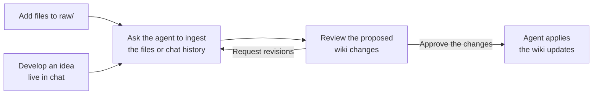

# TTRPG Wiki

Spend more time preparing the next game and less time piecing together what happened in the last six.

Turn session notes and chat ideas into a private campaign notebook you can question during play. Your AI assistant helps organize, link, and update the pages. You review the proposals and decide what becomes part of your campaign—so useful work survives beyond the conversation.

**[Download the blank campaign template (ZIP)](https://github.com/talktocory/ttrpg-wiki/releases/latest/download/ttrpg-wiki-template.zip)** · [Latest release notes](https://github.com/talktocory/ttrpg-wiki/releases/latest)

Use any TTRPG system. **You do not need to know how to code.** For the complete local workflow, install Python 3.11 or newer and the packages in `requirements-dev.txt`; assistants may use them for validation, file inspection, and image processing. Simple Markdown lookups and writing may work without them. You also need access to your chosen AI tool; available features vary. See [setup and testing notes](docs/platforms/compatibility.md).

## What you can ask

| Task | Example prompt |
| --- | --- |
| Look up backstory, lore, or a storyline | “Remind me of this NPC's history and its connection to the current story. Link the source notes.” |
| Find unfinished business | “What loose ends need to be dealt with?” |
| Prepare a session | “Prepare our next session.” |
| Make a random table | “Create a table of random items for the wizard's chamber” |
| Develop a character | “Add a tragic backstory for Princess Darla” |
| Write a player recap | “Summarize what the characters learned, keeping GM secrets out.” |
| Check rewards | “What did the group actually receive? Flag uncertain amounts.” |
| Generate a map image | “Use ttrpg-map-create to create a map for this encounter.” |
| Generate a token image | “Use ttrpg-token-create to create a token for this NPC.” |

**Campaign lookups are read-only:** ask for source links and uncertain details. No approval is needed unless you want to save new or changed material.

**Maps and tokens can be generated as actual images.** In Codex with image generation available, the two image skills use that tool directly. Reference art is optional, and the default is one image per review round. See [image creation](docs/gm-guide.md#generate-maps-and-token-images) for review and export details.

A **skill** is a prepared set of task instructions. You can usually ask in ordinary language; the [GM guide](docs/gm-guide.md) lists skill names when you need them.

## Start your campaign

1. Download or copy the project into a **private folder for one campaign**. A private GitHub repository is optional.
2. [Set up Python and install the project requirements](docs/scripts.md#set-up-the-local-python-environment). This is the baseline for the complete local workflow; it does not require writing Python code.
3. Follow the setup guide for [Codex](docs/platforms/codex.md), [Claude Desktop or Claude Code](docs/platforms/claude-desktop.md), [GitHub Copilot](docs/platforms/github-copilot.md), or [OpenCode v2 with an Ollama model](docs/platforms/opencode-ollama.md). It will help you connect the assistant and configure your [campaign settings](docs/configuration.md).
4. Add notes to `raw/` or develop an idea in chat. Ask the assistant to ingest that material and propose wiki updates.
5. Review the proposed changes and request revisions. When ready, approve the parts you want saved:

> The proposed changes are approved. Please proceed with the appropriate wiki updates

The assistant should save the approved pages, update the campaign index and activity log, and report what changed. If it cannot edit the campaign workspace, correct its access before treating the task as complete. A proposal left in the conversation has not updated the wiki. A Git commit is a separate, optional record of saved changes.

For a guided first task, follow the [first-campaign walkthrough](docs/getting-started.md).

## Where things go

| Folder | Contents |
| --- | --- |
| `raw/` | Original notes and reference documents, preserved during normal use |
| `wiki/gm/` | Private campaign knowledge, session plans, NPCs, places, and rules reminders |
| `wiki/player-safe/` | Reviewed recaps, handouts, and revealed lore |
| `assets/vtt/` | Map and token files; their notes belong on the relevant campaign pages |
| `assets/player-safe/` | Images reviewed for sharing with players |

Start at [wiki/index.md](wiki/index.md) to browse your campaign. Pages are ordinary Markdown text files; use any text editor. Obsidian is optional.

## Keep control of your campaign

New ideas stay separate from established facts. Preparing a scene, reward, or reveal does not mean it happened in play.

Keep the campaign folder private and share only selected, reviewed player files. A “player-safe” folder helps organize those files; it does not prevent access to the rest of the project. Check text, images, and links before sharing.

## More help

- [GM guide](docs/gm-guide.md): everyday requests, session routines, and common questions.
- [Python setup and tools](docs/scripts.md): required environment setup for the complete local workflow, plus checks, image processing, and project-maintenance commands.
- [Sharing text and artwork](docs/provenance.md): sources, permissions, and attribution.
- [Contributing](CONTRIBUTING.md): instructions for people changing the project itself.

This project adapts [Andrej Karpathy's LLM Wiki approach](https://gist.github.com/karpathy/442a6bf555914893e9891c11519de94f) for campaign preparation, GM review, and spoiler protection. The framework and original examples use the [MIT License](LICENSE); imported rules, adventures, and artwork retain their own terms.
