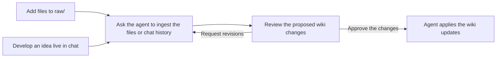

# TTRPG Wiki

Turn your tabletop role playing game (TTRPG) source material, session notes, and chat ideas into a private, AI-powered, campaign notebook that evolves with you and your campaign.

Visual Studio Code is the standard workbench for TTRPG Wiki. It keeps the campaign files, AI chat, terminal, Markdown preview, and Source Control together in one local workspace. Codex, Claude Code, GitHub Copilot, and Ollama provide different AI assistants inside that shared environment.

**[Download the blank campaign template (ZIP)](https://github.com/talktocory/ttrpg-wiki/releases/latest/download/ttrpg-wiki-template.zip)** · [Latest release notes](https://github.com/talktocory/ttrpg-wiki/releases/latest)

## What can this TTRPG Wiki do?

| Skill                                                                    | Function                                                                            |
| ------------------------------------------------------------------------ | ----------------------------------------------------------------------------------- |
| [ttrpg-campaign-init](.agents/skills/ttrpg-campaign-init/SKILL.md)       | Guide campaign setup while preserving existing choices.                             |
| [ttrpg-wiki-ingest](.agents/skills/ttrpg-wiki-ingest/SKILL.md)           | Turn source notes and chat ideas into proposed wiki updates.                        |
| [ttrpg-session-prep](.agents/skills/ttrpg-session-prep/SKILL.md)         | Prepare flexible sessions from campaign context, character goals, and open hooks.   |
| [ttrpg-npc-dialogue](.agents/skills/ttrpg-npc-dialogue/SKILL.md)         | Prepare scene dialogue that respects each NPC's voice, knowledge, and secrets.      |
| [ttrpg-player-safe](.agents/skills/ttrpg-player-safe/SKILL.md)           | Draft and review player recaps, handouts, and revealed lore for spoilers.           |
| [ttrpg-reward-ledger](.agents/skills/ttrpg-reward-ledger/SKILL.md)       | Reconcile confirmed rewards, flag uncertainty, and prevent duplicate awards.        |
| [ttrpg-map-create](.agents/skills/ttrpg-map-create/SKILL.md)             | Generate or refine campaign maps with configured scale and export settings.         |
| [ttrpg-token-create](.agents/skills/ttrpg-token-create/SKILL.md)         | Generate or refine character tokens from descriptions or reference art.             |
| [ttrpg-wiki-maintenance](.agents/skills/ttrpg-wiki-maintenance/SKILL.md) | Find contradictions, stale notes, broken links, and spoiler leaks; propose repairs. |

## What do I need to get started?

For the complete local workflow, you need:

- A copy of the [blank campaign template](https://github.com/talktocory/ttrpg-wiki/releases/latest/download/ttrpg-wiki-template.zip).
- [Python 3.11 or newer](https://www.python.org/downloads/) with the packages from `requirements-dev.txt`.
- [Visual Studio Code](https://code.visualstudio.com/) with the appropriate extensions installed.
- [Git](https://git-scm.com/) is not required but is recommended for local version history.

Choose an assistant and follow its setup guide:

- [OpenAI Codex](docs/platforms/codex.md)
- [Claude Code](docs/platforms/claude-code.md)
- [GitHub Copilot](docs/platforms/github-copilot.md)
- [Ollama](docs/platforms/ollama.md)

## How do I get started?

For a guided first task, follow the [first-campaign walkthrough](docs/getting-started.md).

## Where do I find more info?

- [GM guide](docs/gm-guide.md): everyday requests, session routines, and common questions.
- [Supported assistants](docs/platforms/compatibility.md): setup guides, capabilities, and current testing limits.
- [Script reference](docs/scripts.md): checks, image processing, and project-maintenance commands.
- [Sharing text and artwork](docs/provenance.md): sources, permissions, and attribution.
- [Contributing](CONTRIBUTING.md): instructions for people changing the project itself.

This project adapts [Andrej Karpathy's LLM Wiki approach](https://gist.github.com/karpathy/442a6bf555914893e9891c11519de94f) for campaign preparation, GM review, and spoiler protection. The framework uses the [MIT License](LICENSE); imported rules, adventures, and artwork retain their own terms.
