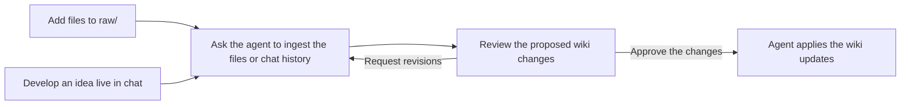

# TTRPG Wiki

Turn your tabletop role playing game (TTRPG) session notes and chat ideas into a private, AI-powered, campaign notebook that evolves with you and your campaign.

**[Download the blank campaign template (ZIP)](https://github.com/talktocory/ttrpg-wiki/releases/latest/download/ttrpg-wiki-template.zip)** · [Latest release notes](https://github.com/talktocory/ttrpg-wiki/releases/latest)

## What can this TTRPG Wiki do?

| Task | Example prompt |
| --- | --- |
| Import content | "Review the newly added source material and update the wiki." |
| Look up backstory, lore, or a storyline | “Remind me of this NPC's history and its connection to the current story. Link the source notes.” |
| Find unfinished business | “What loose ends need to be dealt with?” |
| Prepare a session | “Prepare our next session.” |
| Make a random table | “Create a table of random items for the wizard's chamber” |
| Develop a character | “Add a tragic backstory for Princess Darla” |
| Write a player recap | “Summarize what the characters learned, keeping GM secrets out.” |
| Check rewards | “What did the group actually receive? Flag uncertain amounts.” |
| Generate a map image | “Create a map for this encounter.” |
| Generate a token image | “Create a token for this NPC.” |

## How do I get started?

For a guided first task, follow the [first-campaign walkthrough](docs/getting-started.md).

## Where do I find more info?

- [GM guide](docs/gm-guide.md): everyday requests, session routines, and common questions.
- [Supported assistants](docs/platforms/compatibility.md): setup guides, capabilities, and current testing limits.
- [Script reference](docs/scripts.md): checks, image processing, and project-maintenance commands.
- [Sharing text and artwork](docs/provenance.md): sources, permissions, and attribution.
- [Contributing](CONTRIBUTING.md): instructions for people changing the project itself.

This project adapts [Andrej Karpathy's LLM Wiki approach](https://gist.github.com/karpathy/442a6bf555914893e9891c11519de94f) for campaign preparation, GM review, and spoiler protection. The framework and original examples use the [MIT License](LICENSE); imported rules, adventures, and artwork retain their own terms.
